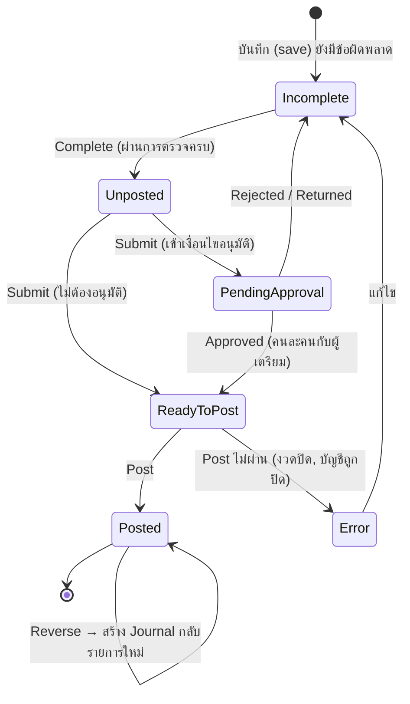
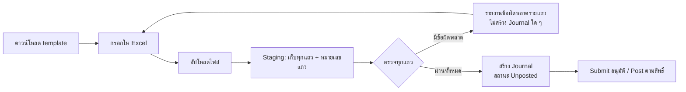

---
tags:
  - erp/design
  - erp/gl
---

# GL: Process logic (แนวทางเลียนแบบ Oracle Fusion Cloud ERP)

ใช้กับ ticket [12](issues/12-gl-journal-entry-posting.md), [36](issues/36-file-based-data-import.md), [42](issues/42-journal-import-object.md), [37](issues/37-sla-subledger-accounting.md), [38](issues/38-tax-registration-tax-register.md), [39](issues/39-vat-reports-pp30.md), [40](issues/40-wht-certificates-pnd3-pnd53.md), [41](issues/41-pnd1-payroll-wht.md)
มาตรฐาน: [CODING_STANDARDS](../../docs/CODING_STANDARDS.md)

> เป็นแนวทางออกแบบ ไม่ใช่สำเนาพฤติกรรมของ Oracle ทุกจุด ข้อใดขัดกับข้อตัดสินใจ D/P ในเอกสาร 01 ให้ยึด D/P
> กฎภาษี อัตรา วันกำหนดยื่น และรูปแบบแบบฟอร์ม ต้องให้ทีมภาษีตรวจยืนยันกับประกาศกรมสรรพากรล่าสุดก่อนใช้งานจริง และเก็บเป็นค่าตั้งค่า (configuration) ไม่ hard-code

## 1. คำศัพท์เทียบ Oracle Fusion

| Fusion | ICC ERP | ความหมาย |
| --- | --- | --- |
| Ledger (Primary) | Ledger ใน S01 | 1 นิติบุคคล = 1 Primary Ledger, THB เท่านั้น (D06) แยก ICC/ITK (ADR-0002) |
| Chart of Accounts / Account combination | ticket 06 | รหัสบัญชีเต็มจาก segment เช่น Company-CostCenter-Account-SubAccount |
| Accounting Calendar / Period status | ticket 04 | Never Opened, Future Entry, Open, Closed, Permanently Closed |
| Journal Batch → Journal → Journal Line | เหมือนกัน | Batch รวมหลาย Journal ที่ post พร้อมกัน, Journal = 1 ใบสำคัญ ต้อง balance |
| Journal Source | Source | Manual, Spreadsheet, Payables, Receivables, Assets, Inventory, … |
| Journal Category | Category | Adjustment, Accrual, Reclass, Payroll, Tax, … (กำหนด auto-reverse และ approval ได้) |
| Journal Approval (AMX) | ticket 03 | อนุมัติตามวงเงิน/category/ledger ผู้เตรียมอนุมัติเองไม่ได้ (D07) |
| Document Sequencing | ticket 05 | เลขที่ใบสำคัญต่อ Ledger + Category + ปีบัญชี |
| GL_INTERFACE + Import Journals (FBDI) | บริการนำเข้ากลาง (ticket 36) + Journal Import (ticket 42) | อัปโหลด Excel → staging → ตรวจ → สร้าง Journal |
| Subledger Accounting (SLA) | ticket 37 | โมดูลอื่นส่ง accounting event แล้วได้ Journal ที่ source = โมดูลนั้น |
| GL Balances | Balance table | ยอดต่อ ledger + account + period (begin, period Dr/Cr, end) |
| Tax Reporting Ledger | Tax register (ticket 38) | ทะเบียนรายการภาษีที่ใช้ออกรายงานภาษีทุกฉบับ |

## 2. Setup ที่ต้องมีก่อนคีย์ Journal

1. Ledger + Legal Entity + เลขผู้เสียภาษี (S01, มีแล้ว)
2. ผังบัญชีและ account combination ที่ใช้งานได้ (ticket 06): บัญชีที่เป็นหัวรวม (summary/parent) คีย์ไม่ได้, combination ต้องผ่าน cross-validation rule
3. ปฏิทินบัญชีและสถานะงวด (ticket 04)
4. Source และ Category (ตั้งค่าใน GL): ค่าเริ่มต้น Manual, Spreadsheet และ Category: Adjustment, Accrual (auto-reverse), Reclass, Tax, Payroll
5. กฎอนุมัติ Journal (ticket 03): เช่น ต้องอนุมัติเมื่อยอดรวม Dr ≥ วงเงินที่ตั้ง หรือ category = Tax/Payroll
6. เลขที่ใบสำคัญ (ticket 05)
7. สถานประกอบการ/สาขาทางภาษี และรหัสภาษี (ticket 38 + 06)

## 3. วงจรชีวิต Journal

- **Incomplete:** ยังแก้ได้ทุกอย่าง บันทึกได้แม้ไม่ balance (draft)
- **Complete/Unposted:** ผ่านการตรวจทั้งหมดแล้ว แก้ไขได้แต่จะกลับไปเป็น Incomplete และล้างการอนุมัติ (D07)
- **Posted:** แก้ไขและลบไม่ได้ ใช้ Reverse เท่านั้น (CODING_STANDARDS §1)
- ลบได้เฉพาะ Journal ที่ยังไม่เคย submit

## 4. Input 1: หน้าจอคีย์ Journal (G03)

**Header ของ Batch:** ชื่อ Batch (สร้างอัตโนมัติได้), Source (Manual), งวด (จาก accounting date), รายละเอียด
**Header ของ Journal:** Ledger (จากบริษัทที่เลือกใน header ของแอป), Category, Accounting date, คำอธิบาย, Reference (เลขเอกสารอ้างอิงภายนอก), เลขที่ใบสำคัญ (ออกตอน Complete), ตัวเลือก Reverse อัตโนมัติ (วันที่/งวดที่จะกลับ)
**Lines:** ลำดับ, รหัสบัญชี (เลือกจาก combination ที่ใช้งานได้ พร้อมชื่อบัญชี), Debit, Credit, คำอธิบายบรรทัด และแผง "ข้อมูลภาษี" (ดูข้อ 8)

กฎตรวจ (ตอน Complete และตอน Post ซ้ำอีกครั้ง):
1. Journal ต้อง balance: ผลรวม Debit = ผลรวม Credit (ทศนิยม 2 ตำแหน่ง ไม่มีบัญชีพักอัตโนมัติ)
2. แต่ละบรรทัดมี Debit หรือ Credit อย่างใดอย่างหนึ่ง มากกว่า 0
3. accounting date อยู่ในงวด Open (Complete ได้ในงวด Future Entry แต่ Post ไม่ได้จนงวดเปิด)
4. ทุกบัญชีอยู่ใน Ledger เดียวกับ Journal ใช้งานได้ ณ วันที่ และไม่ใช่บัญชีหัวรวม
5. บรรทัดที่เป็นบัญชีภาษี (กำหนดที่ tax code) ต้องกรอกข้อมูลภาษีครบ
6. ห้ามมีบรรทัดข้ามบริษัท (ไม่มี intercompany ในรุ่นแรก)

หน้าจอ: ตารางบรรทัดแบบคีย์ต่อเนื่องได้ด้วยคีย์บอร์ด, แสดงยอดรวม Dr/Cr และผลต่างตลอดเวลา, ปุ่ม Save / Complete / Submit / Post / Reverse ตามสถานะและสิทธิ์, แท็บ เอกสารแนบ และประวัติ

## 5. Input 2: อัปโหลด Journal จาก Excel (Journal Import แบบ FBDI)

> ใช้**บริการนำเข้าไฟล์กลาง** แบบ Oracle FBDI ([import-framework.md](import-framework.md), ticket 36) โดย Journal Import เป็น import object แรก (ticket 42) ลำดับขั้น: template → อัปโหลด → Load Interface File → Import → Correct Import Errors / Purge ส่วนกฎด้านล่างคือกฎเฉพาะของ Journal

- ไฟล์ template: [journal-upload-template.xlsx](../../docs/templates/journal-upload-template.xlsx) (sheet: คำแนะนำ, GL_INTERFACE, ตัวอย่าง, รายการค่า)
- หนึ่งแถวในแท็บ `GL_INTERFACE` = หนึ่งบรรทัด Journal · แถวที่ BATCH_NAME + JOURNAL_NAME + บริษัท + source + category + accounting date เหมือนกันรวมเป็น Journal เดียว (grouping แบบ Fusion) · source = Spreadsheet
- **ทั้งไฟล์ผ่านหรือไม่ผ่านพร้อมกัน** ถ้าแถวใดผิดจะไม่สร้าง Journal เลย เพื่อไม่ให้ข้อมูลครึ่งเดียวค้างในระบบ
- กฎตรวจชุดเดียวกับหน้าจอคีย์ (ข้อ 4) บวก: header ของแถวที่ key เดียวกันต้องตรงกัน, บริษัทต้องตรงกับบริษัทที่ผู้อัปโหลดมีสิทธิ์, ไฟล์เดิม (fingerprint) อัปโหลดซ้ำไม่ได้
- รายงานข้อผิดพลาดบอก เลขแถว, คอลัมน์, ข้อความภาษาไทย ดาวน์โหลดเป็น Excel ที่มีคอลัมน์ "ข้อผิดพลาด" เพิ่มได้
- จำกัดขนาดไฟล์และจำนวนแถว (ค่าเริ่มต้น 5 MB / 5,000 แถว) รับเฉพาะ .xlsx และไม่รันสูตรหรือ macro จากไฟล์

## 6. Process: Post และยอดคงเหลือ

1. ผู้มีสิทธิ์ Post เลือก Batch ที่ Ready to post
2. ในหนึ่ง transaction: ล็อก Batch, ตรวจกฎข้อ 4 ซ้ำ, ล็อกสถานะงวด (กัน race กับการปิดงวด T10), อัปเดตตารางยอด (ledger + account + period: period Dr/Cr), เปลี่ยนสถานะเป็น Posted, เขียน tax register (ข้อ 8), audit
3. ใช้ `Idempotency-Key` กันกด Post ซ้ำ
4. ยอดยกมาของปีใหม่มาจากการปิดปี (ticket 33)
5. **Account inquiry:** ดูยอดต่อบัญชี/งวด แล้วเจาะลงไปที่ Journal และเอกสารต้นทาง
6. **Trial Balance:** opening, period Dr/Cr, closing ต่อ company/ledger ทั้งบริษัทต้อง Dr = Cr

## 7. Reverse

- เลือก Journal ที่ Posted → กำหนดวันที่/งวดของการกลับรายการ → วิธี: สลับ Dr/Cr (ค่าเริ่มต้น)
- สร้าง Journal ใหม่ที่อ้าง Journal เดิม ผ่านอนุมัติ/Post ตามกฎปกติ
- Category ที่ตั้ง auto-reverse (เช่น Accrual) สร้าง reversal ให้อัตโนมัติในงวดถัดไปเมื่องวดนั้นเปิด
- Journal หนึ่งใบกลับรายการได้ครั้งเดียว

## 8. ภาษีบน Journal → Tax register

ช่วงที่ยังไม่มี AP/AR รายการภาษีมาจาก Journal (คีย์มือหรืออัปโหลด) เมื่อมี AP/AR แล้ว (ticket 21, 25) ให้เขียนลง tax register ชุดเดียวกันผ่าน SLA รายงานภาษีทุกฉบับอ่านจาก **tax register** ไม่อ่านจาก Journal ตรง ๆ

ข้อมูลภาษีต่อบรรทัด (กรอกเมื่อบรรทัดใช้บัญชีภาษีหรือเลือกประเภทภาษี):

| ประเภท | ข้อมูลที่ต้องมี |
| --- | --- |
| VAT ภาษีซื้อ | tax code (อัตรา), มูลค่าก่อนภาษี (ฐาน), ภาษี, เลขที่/วันที่ใบกำกับ, ชื่อผู้ขาย, เลขผู้เสียภาษี 13 หลัก, สาขาผู้ขาย (00000 = สำนักงานใหญ่), เดือนภาษีที่ขอเครดิต |
| VAT ภาษีขาย | tax code, ฐาน, ภาษี, เลขที่/วันที่ใบกำกับ, ชื่อผู้ซื้อ, เลขผู้เสียภาษี, สาขาผู้ซื้อ |
| WHT ภาษีหัก ณ ที่จ่าย | แบบ (ภ.ง.ด.3 บุคคล / ภ.ง.ด.53 นิติบุคคล), ประเภทเงินได้ (มาตรา 40), อัตรา, เงินได้ที่จ่าย, ภาษีที่หัก, วันที่จ่าย, ผู้รับเงิน (ชื่อ ที่อยู่ เลขผู้เสียภาษี สาขา), เงื่อนไข (1 หัก ณ ที่จ่าย, 2 ออกให้ตลอดไป, 3 ออกให้ครั้งเดียว) |

กฎตรวจ:
- ภาษี = ฐาน × อัตรา ปัดตามนโยบาย (ยอมให้ต่างตามค่า tolerance ที่ตั้งได้ เพราะใบกำกับจริงอาจปัดต่าง)
- ยอดภาษีใน tax register ต้องเท่ายอดบรรทัดบัญชีภาษีของ Journal
- ภาษีซื้อ: เดือนที่ขอเครดิตต้องไม่ก่อนเดือนของใบกำกับ และไม่เกินระยะที่กฎหมายกำหนด (ค่าตั้งค่า เริ่มต้น 6 เดือน)
- สาขาเป็นตัวเลข 5 หลัก, เลขผู้เสียภาษี 13 หลัก
- ใบกำกับเลขเดียวกันของผู้ขายรายเดียวกันห้ามขอเครดิตซ้ำ

สถานประกอบการ (Tax registration): แต่ละ Legal Entity มีสาขาทางภาษีได้หลายแห่ง (00000 = สำนักงานใหญ่) และตั้งค่าได้ว่ายื่น ภ.พ.30 แยกสาขาหรือรวม

## 9. Output

| รายงาน | ที่มา | เนื้อหาหลัก | ticket |
| --- | --- | --- | --- |
| รายงานภาษีซื้อ | tax register: VAT input ตามเดือนที่ขอเครดิต | หัว: ชื่อผู้ประกอบการ, เลขผู้เสียภาษี, สถานประกอบการ, เดือน/ปีภาษี · บรรทัด: ลำดับ, วันที่และเลขที่ใบกำกับ, ชื่อผู้ขาย, เลขผู้เสียภาษี, สาขา, มูลค่า, ภาษี · รวมท้าย | 39 |
| รายงานภาษีขาย | tax register: VAT output ตามเดือนภาษี | เหมือนภาษีซื้อ แต่เป็นผู้ซื้อ | 39 |
| ภ.พ.30 | สรุปจากรายงานภาษีซื้อ/ขายของเดือน | ยอดขาย (ที่ต้องเสียภาษี/อัตรา 0/ยกเว้น), ภาษีขาย, ยอดซื้อที่มีสิทธิ์, ภาษีซื้อ, ภาษีที่ต้องชำระหรือชำระเกิน, ภาษีชำระเกินยกมา | 39 |
| หนังสือรับรอง 50 ทวิ | tax register: WHT ต่อผู้รับเงินต่อการจ่าย | เลขที่/เล่มที่, ผู้จ่าย, ผู้รับ, ประเภทเงินได้, วันที่จ่าย, เงินได้, ภาษีที่หัก, เงื่อนไข | 40 |
| ภ.ง.ด.3 | WHT ที่ผู้รับเป็นบุคคลธรรมดา ต่อเดือน | ใบแนบรายผู้รับ + ใบสรุปยอด | 40 |
| ภ.ง.ด.53 | WHT ที่ผู้รับเป็นนิติบุคคล ต่อเดือน | ใบแนบรายผู้รับ + ใบสรุปยอด | 40 |
| ภ.ง.ด.1 | ข้อมูลเงินเดือนนำเข้า (มาตรา 40(1)/(2)) ต่อเดือน | ใบแนบรายพนักงาน + ใบสรุป | 41 |

ทุกรายงาน: เลือกบริษัท, สถานประกอบการ, เดือนภาษี · ดูบนจอ, ส่งออก Excel และ PDF · เก็บ snapshot ตอน "ยืนยันยื่น" พร้อมเลขฉบับ ถ้าแก้หลังยืนยันต้องเป็นฉบับเพิ่มเติม (ยื่นเพิ่มเติม) ฉบับเดิมยังอยู่ · ยอดรวมในไฟล์ต้องตรงกับหน้าจอ
แฟ้มสำหรับยื่นออนไลน์ (e-Filing / RD Prep) อยู่นอกขอบเขตรอบแรก ต้องตัดสินใจรูปแบบไฟล์ก่อน

วันกำหนดยื่น (ค่าตั้งค่า, ตรวจกับกรมสรรพากรก่อนใช้งาน): ภ.พ.30 ภายในวันที่ 15 ของเดือนถัดไป, ภ.ง.ด.1/3/53 ภายในวันที่ 7 ของเดือนถัดไป, ยื่นออนไลน์ได้รับขยายเวลาตามประกาศ

## 10. สิทธิ์ (เพิ่มใน authorization matrix)

| บทบาท | ทำได้ |
| --- | --- |
| GL accountant | คีย์/อัปโหลด/Complete/Submit Journal, ดูรายงานภาษี |
| GL manager | อนุมัติ Journal (ไม่ใช่ของตัวเอง), Post, Reverse, ยืนยันยื่นแบบภาษี |
| Tax officer (ใหม่) | ตั้งค่าสถานประกอบการ/WHT code, ออก 50 ทวิ, ยืนยันยื่นแบบ |
| Payroll officer (ใหม่) | นำเข้าข้อมูลเงินเดือน, ดู ภ.ง.ด.1 (ข้อมูลส่วนบุคคลเห็นเฉพาะบทบาทนี้) |
| Auditor | ดูทุกอย่างในบริษัทที่มีสิทธิ์ แก้ไม่ได้ |

## 11. ประเด็นที่ต้องตัดสินใจ — ตัดสินแล้วใน ticket 01 (P14–P25 ใน 01-scope-decisions.md)

โครงสร้างผังบัญชี → P14 / ADR-0005 · อนุมัติ Journal → P17 · ภ.พ.30 แยก/รวม → P18 · ข้อมูลเงินเดือน → P22 · e-Filing → P23 (นอกรอบแรก)

รายการเดิม:

1. โครงสร้าง segment ของผังบัญชี (ใช้ใน template และหน้าจอ)
2. วงเงินและ category ที่ต้องอนุมัติ Journal
3. ยื่น ภ.พ.30 แยกสาขาหรือรวม
4. แหล่งข้อมูลเงินเดือนสำหรับ ภ.ง.ด.1 (ระบบเงินเดือนภายนอกส่งไฟล์รูปแบบใด)
5. ต้องการแฟ้ม e-Filing ในรอบแรกหรือไม่
