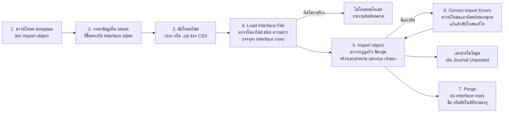

---
tags:
  - erp/design
  - erp/import
---

# บริการนำเข้าไฟล์กลาง (แบบ Oracle FBDI)

ทุกโมดูลนำเข้าข้อมูลจาก Excel/CSV ผ่านบริการเดียว ใช้ลำดับขั้นและคำศัพท์แบบ Oracle Fusion **File-Based Data Import (FBDI)** · ใช้กับ ticket [36](issues/36-file-based-data-import.md) (บริการกลาง), [42](issues/42-journal-import-object.md) (Journal Import เป็น object แรก) และ ticket ของโมดูลที่มี import object
มาตรฐาน: [CODING_STANDARDS](../../docs/CODING_STANDARDS.md) · ADR: [0004](../../docs/adr/0004-background-import-jobs.md)

## 1. ลำดับขั้นแบบ FBDI

| ขั้น | Oracle FBDI | ICC ERP |
| --- | --- | --- |
| Template | ไฟล์ XLSM ต่อ object มีแท็บ Instructions and CSV Generation และแท็บข้อมูลที่ชื่อตรงกับ interface table (เช่น GL_INTERFACE) ห้ามสลับ/ลบคอลัมน์ ซ่อนได้ [1] | ไฟล์ **.xlsx (ไม่มี macro)** ต่อ object มีแท็บ "คำแนะนำ" และแท็บข้อมูลชื่อเดียวกับ interface ของเรา (เช่น `GL_INTERFACE`) กฎคอลัมน์เหมือน FBDI · เก็บเวอร์ชัน template ในไฟล์ |
| ไฟล์ที่อัปโหลด | กด Generate CSV ได้ไฟล์ .zip ของ CSV [1] | รับได้ทั้ง **.xlsx ตรง** (ไม่ต้องรัน macro ฝั่งผู้ใช้) และ **.zip ของ CSV ชื่อ `<INTERFACE>.csv`** สำหรับระบบภายนอกที่ส่งไฟล์อัตโนมัติ |
| ที่เก็บไฟล์ | UCM account ต่อ object เช่น `fin/generalLedger/import` [2] | File store นอก web root แยกโฟลเดอร์ต่อ object (`gl/journal`, `cash/bank-statement`, …) ชื่อไฟล์ระบบสร้าง เก็บ fingerprint |
| Load | process **Load Interface File for Import** เลือก import process + data file [1] | job `LOAD` ต่อไฟล์: ตรวจเวอร์ชัน template, ชื่อ sheet/คอลัมน์, ชนิด, ความยาว, ค่าบังคับ · **ถ้าโครงไฟล์ผิด ไม่โหลดเลย** |
| Interface | ตารางต่อ object (GL_INTERFACE ฯลฯ) สถานะแถว NEW [1] | ตาราง interface กลาง เก็บค่าแต่ละแถวแบบ typed JSON พร้อม `load_request_id`, เลขแถว, `group_id`, สถานะ `NEW / ERROR / PROCESSED`, ข้อผิดพลาด, id เอกสารที่สร้าง (ต่างจาก Fusion: ตารางเดียวใช้ทุก object ดู §4) |
| Import | process ต่อ object เช่น **Import Journals** [1][2] | job `IMPORT` ต่อ object: กฎธุรกิจ → จัดกลุ่ม → เรียก service ของโมดูลเจ้าของ (ไม่เขียนตารางข้ามโมดูล) |
| แก้ข้อผิดพลาด | Correct Import Errors (ดาวน์โหลด worksheet แถวผิด แก้แล้วอัปโหลด) หรือ Delete Import Data [1] | **Correct Import Errors**: ดาวน์โหลดแถว ERROR เป็น template เดิมพร้อมคอลัมน์ข้อผิดพลาด แก้แล้วอัปโหลดเป็นการแก้ของ load เดิม · **Delete Import Data** ลบแถว ERROR ของ load |
| Purge | Purge Interface Tables (มือ ตาม load request) และล้างอัตโนมัติตามอายุ [3] | job `PURGE` มือ ตาม load request และอัตโนมัติเมื่อแถวเกินอายุที่ตั้ง (ค่าเริ่มต้น 30 วัน; ข้อมูลเงินเดือนสั้นกว่า) |
| ติดตามงาน | Scheduled Processes (สถานะ, log, output) | หน้า **งานนำเข้า**: job, สถานะ (Queued / Running / Succeeded / Warning / Error), จำนวนแถว, log, ไฟล์ผลลัพธ์ |
| เชื่อมระบบ | ERP integration service อัปโหลดและสั่งรันผ่าน web service | REST: อัปโหลดไฟล์ + สั่ง load/import + ดูสถานะ ใช้สิทธิ์เดียวกับหน้าจอ |

## 2. Import object registry

แต่ละ object ลงทะเบียนครั้งเดียว บริการกลางทำทุกอย่างที่เหลือ

| ส่วน | ความหมาย |
| --- | --- |
| `code` | เช่น `GL_JOURNAL_IMPORT` |
| โมดูลเจ้าของ + สิทธิ์ | ใครดาวน์โหลด template / อัปโหลด / import / purge ได้ |
| interface(s) | ชื่อ (`GL_INTERFACE`) และคอลัมน์: ชื่อ, ชนิด (text, decimal(2), decimal(6), date, lookup), ความยาว, บังคับ, คำอธิบายไทย |
| เวอร์ชัน template | ไฟล์ที่เวอร์ชันไม่ตรงถูกปฏิเสธพร้อมลิงก์ดาวน์โหลดเวอร์ชันใหม่ |
| grouping rule | คอลัมน์ที่ใช้รวมแถวเป็นเอกสาร (Journal: batch name, journal name, บริษัท, source, category, accounting date) |
| หน่วยของความสำเร็จ | `LOAD` = ทั้งไฟล์ (ตาม FBDI) · `IMPORT` = กำหนดต่อ object: **ทั้ง load** (Journal ตามที่ตกลงไว้), **ต่อกลุ่ม** (เช่น AP invoice ใบที่ถูกเข้าได้ ใบที่ผิดค้าง) |
| handler | ฟังก์ชันของโมดูลเจ้าของ: `validate(group) → errors` และ `create(trx, group, actor) → document id` |
| ข้อจำกัด | ขนาดไฟล์, จำนวนแถว, อายุ purge |

## 3. Object ที่วางไว้ (ตาม Fusion)

| Object | Fusion เทียบเคียง | interface | ticket |
| --- | --- | --- | --- |
| Journal | Journal Import [2] | `GL_INTERFACE` | 42 |
| ผังบัญชี (account combinations) | Chart of accounts / segment values import | `GL_ACCOUNT_INTERFACE` | 06 (ภายหลัง) |
| ใบแจ้งหนี้เจ้าหนี้ | Payables Standard Invoice Import | `AP_INVOICES_INTERFACE`, `AP_INVOICE_LINES_INTERFACE` | 21 |
| ใบแจ้งหนี้ลูกหนี้ | AutoInvoice Import | `AR_INTERFACE_LINES` | 25 |
| เงินรับ | Receivables Standard Receipt Import | `AR_RECEIPTS_INTERFACE` | 26 |
| Statement ธนาคาร | Cash Management Bank Statement Data Import | `CE_STATEMENT_HEADERS_INT`, `CE_STATEMENT_LINES_INT`, `CE_STMT_BALANCES_INT` | 31 |
| ต้นทุนรอตั้งสินทรัพย์ | Fixed Asset Mass Additions Import | `FA_MASS_ADDITIONS` | 28 |
| ตรวจนับสินทรัพย์ | Physical inventory import | `FA_PHYSICAL_INVENTORY_INT` | 30 |
| รายการภาษี (ข้อมูลยกมา/ภายนอก) | Tax Entry Repository Data Upload | `TAX_ENTRY_INTERFACE` | 38 |
| ข้อมูลเงินเดือนสำหรับ ภ.ง.ด.1 | (ไม่มีใน Fusion Financials) | `PAYROLL_TAX_INTERFACE` | 41 |

ชื่อ interface ตั้งให้คล้าย Fusion เพื่อให้ทีมที่คุ้น Oracle เดาได้ แต่โครงคอลัมน์เป็นของเรา ไม่ได้คัดลอกจาก Oracle

## 4. การตัดสินใจที่ต่างจาก Fusion (และเหตุผล)
1. **ไม่ใช้ macro:** template เป็น .xlsx ธรรมดา ระบบอ่านไฟล์ Excel ได้เอง ผู้ใช้ไม่ต้องเปิด macro (ลดความเสี่ยงไฟล์แนบที่มี macro) ส่วน .zip ของ CSV ยังรับได้เหมือน FBDI
2. **ตาราง interface กลางตารางเดียว** (ค่าแถวเป็น typed JSON ตามนิยามคอลัมน์ใน registry) แทนตารางจริงต่อ object เพื่อให้เพิ่ม object ใหม่ได้โดยไม่ต้องสร้างตารางและหน้าจอใหม่ ข้อมูลยังถูกตรวจชนิดตอน load และเอกสารจริงยังสร้างผ่าน service ของโมดูลเจ้าของ
3. **งานเบื้องหลัง (job) ในฐานข้อมูล:** load/import ไฟล์ใหญ่ไม่ควรค้าง request · ใช้ตารางงานใน PostgreSQL และตัวรันงานใน API ตัวเดิม (ไม่มี message broker) แต่ละงานทำใน transaction ของตัวเอง และการสร้างเอกสารยังเป็น transaction เดียวต่อหน่วยตาม ADR-0001 → บันทึกเป็น **ADR-0004**
4. **Load ทั้งไฟล์หรือไม่โหลด** เหมือน FBDI ส่วน Import กำหนดหน่วยต่อ object

## 5. ความปลอดภัย (เพิ่มจาก CODING_STANDARDS §5)
- ตรวจนามสกุล + magic bytes, ขนาดไฟล์, จำนวนแถว ก่อน parse
- .zip: จำกัดจำนวนไฟล์และขนาดหลังแตก (กัน zip bomb), ชื่อไฟล์ใน zip ต้องตรงชื่อ interface (กัน path traversal), ไม่แตกลงดิสก์ตามชื่อที่ส่งมา
- Excel: อ่านเฉพาะค่าในเซลล์ ไม่ประมวลผลสูตร/macro/ลิงก์ภายนอก, ปฏิเสธ .xlsm/.xls
- ไฟล์ที่ระบบสร้างกลับ (แถวผิด): ค่าที่ขึ้นต้นด้วย `=`, `+`, `-`, `@` ต้องใส่ `'` นำหน้า กัน CSV/formula injection
- ทุกแถวตรวจว่าบริษัท/OU อยู่ในสิทธิ์ผู้อัปโหลด (scope grant) ไม่ใช่แค่ตรวจที่ไฟล์
- สิทธิ์แยก: ดาวน์โหลด template / อัปโหลด / import / purge ต่อ object
- audit: อัปโหลด, load, import, แก้ไข, ลบ, purge พร้อม fingerprint และผู้ทำ
- ข้อมูลอ่อนไหวใน interface (เงินเดือน, เลขบัตร) เห็นเฉพาะบทบาทที่กำหนด และ purge เร็วกว่าปกติ
- ไม่ log ค่าของแถว เขียนเฉพาะเลขแถวและรหัสข้อผิดพลาด

## แหล่งอ้างอิง (Oracle, สรุปด้วยคำของเรา)
1. [How Journal Import Data Is Processed (26D)](https://docs.oracle.com/en/cloud/saas/financials/26d/faugl/how-journal-import-data-is-processed.html)
2. [Journal Import FBDI object (26D)](https://docs.oracle.com/en/cloud/saas/financials/26d/oefbf/journalimport-3096.html) · [Financials File-Based Data Imports (26D)](https://docs.oracle.com/en/cloud/saas/financials/26d/oefbf/financials-file-based-data-imports.html)
3. [Purge Interface Tables (SCM 25D)](https://docs.oracle.com/en/cloud/saas/supply-chain-and-manufacturing/25d/faspc/purge-interface-tables.html) · [Load Data into Tables (Procurement 26A)](https://docs.oracle.com/en/cloud/saas/procurement/26a/oefbp/load-data-into-tables.html)
4. [How Bank Statements Import Data Is Processed (26D)](https://docs.oracle.com/en/cloud/saas/financials/26d/fappp/how-bank-statements-import-data-is-processed.html)
