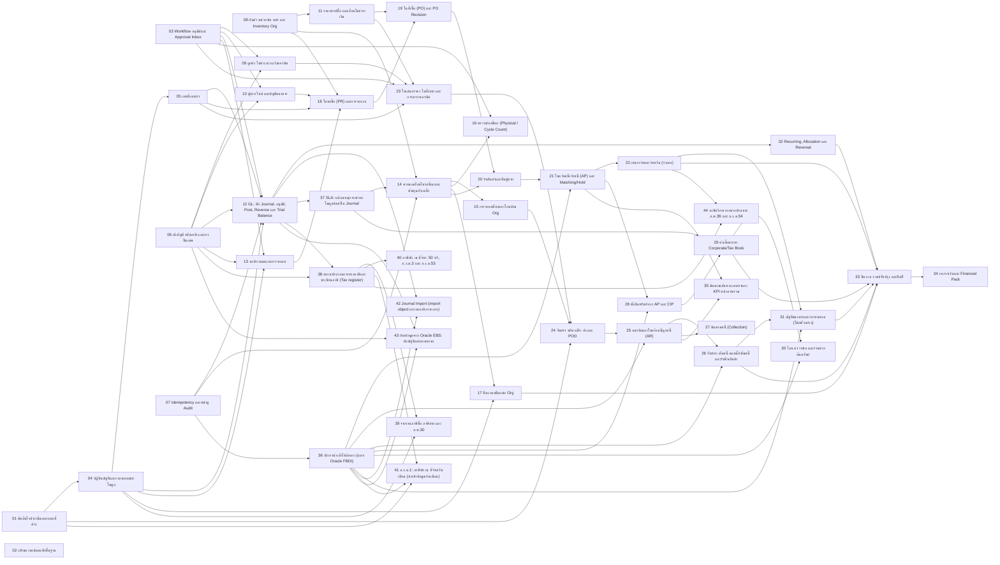

---
tags:
  - erp/index
---

# ERP Phase 1 — รายการ ticket

Spec: [spec.md](spec.md) · มาตรฐานโค้ดและความปลอดภัย: [CODING_STANDARDS](../../docs/CODING_STANDARDS.md)

กระบวนการ GL และภาษี: [gl-process.md](gl-process.md)

อ้างอิง Oracle Fusion Cloud Financials (GL, AP, AR, FA, Cash, Tax): [fusion-reference/index.md](fusion-reference/index.md)

บริการนำเข้าไฟล์กลางแบบ Oracle FBDI: [import-framework.md](import-framework.md)

กฎภาษี P18–P21 (ตอบโดย Claude แทนทีมภาษี รอผู้เชี่ยวชาญทบทวน): [tax-review-p18-p21.md](tax-review-p18-p21.md)

สถานะอยู่ในบรรทัด `**Status:**` ของแต่ละไฟล์ (`ready-for-agent`, `ready-for-human`, `claimed`, `resolved`) ticket ที่ตัวบล็อกเป็น resolved ครบแล้วเริ่มได้

ทำเสร็จแล้วก่อนชุดนี้: login/session, S01 องค์กร, S02 ผู้ใช้และสิทธิ์, reset password, CI

## Foundation

| # | Ticket | หน้าจอ | Blocked by |
| --- | --- | --- | --- |
| 01 | [ตัดสินใจประเด็นออกแบบที่ค้าง](issues/01-resolve-open-design-decisions.md) | — | — |
| 02 | [เสริมความปลอดภัยพื้นฐาน](issues/02-security-hardening.md) | Login | — |
| 03 | [Workflow อนุมัติและ Approval Inbox](issues/03-approval-workflow-inbox.md) | S03 Workflow, H02 Approval Inbox | — |
| 04 | [ปฏิทินบัญชีและงวดของแต่ละโมดูล](issues/04-fiscal-calendar-periods.md) | S04 Numbering/Period (ส่วนงวด) | 01 |
| 05 | [เลขที่เอกสาร](issues/05-document-numbering.md) | S04 Numbering/Period (ส่วนเลขที่) | 04 |
| 06 | [ผังบัญชี รหัสภาษี และการปัดเศษ](issues/06-chart-of-accounts-tax.md) | S05 Tax/Accounts | — |
| 07 | [Idempotency และหน้าดู Audit](issues/07-idempotency-audit-viewer.md) | Audit log (ใหม่) | — |
| 08 | [สินค้า หน่วยนับ คลัง และ Inventory Org](issues/08-items-uom-warehouses.md) | M03 Item/UOM, M05 Warehouse/Locator, S01 (Inventory Org) | — |
| 09 | [ลูกค้า ไซต์ และวงเงินเครดิต](issues/09-customers-credit.md) | M01 Customer/Site/Credit | 03, 06 |
| 10 | [ผู้ขาย ไซต์ และบัญชีธนาคาร](issues/10-suppliers-bank.md) | M02 Supplier/Site/Bank | 03, 06 |
| 11 | [ราคาขาย/ซื้อ และเงื่อนไขชำระเงิน](issues/11-price-lists-terms.md) | M04 Price/Terms | 08 |
| 12 | [GL: คีย์ Journal, อนุมัติ, Post, Reverse และ Trial Balance](issues/12-gl-journal-entry-posting.md) | G03 Journal, G05 Reversal, Account inquiry (ใหม่), CL04 TB | 03, 04, 05, 06, 07 |
| 13 | [งบประมาณและการจองงบ](issues/13-budget-reservations.md) | B01 Budget Versions, B02 Budget Detail, B03 Reservation Ledger, B04 Transfer/Increase | 03, 04, 06 |
| 36 | [บริการนำเข้าไฟล์กลาง (แบบ Oracle FBDI)](issues/36-file-based-data-import.md) | งานนำเข้า (ใหม่): อัปโหลด, Load, Import, Correct Import Errors, Purge | 07 |

## Inventory Core

| # | Ticket | หน้าจอ | Blocked by |
| --- | --- | --- | --- |
| 14 | [ความเคลื่อนไหวสต็อกและต้นทุนถัวเฉลี่ย](issues/14-stock-movements-costing.md) | I01 On-hand, I02 Movements, I08 Cost History/Valuation | 08, 37, 07 |
| 15 | [การจองสต็อกและโอนข้าม Org](issues/15-reservations-transfers.md) | I03 Reservations, I04 Transfer | 14 |
| 16 | [ตรวจนับสต็อก (Physical / Cycle Count)](issues/16-physical-cycle-count.md) | I05 Count Session, I06 Count Entry/Recount, I07 Variance Approval | 14, 03 |
| 17 | [ปิดงวดสต็อกต่อ Org](issues/17-inventory-period-close.md) | I09 Org Period | 14, 04 |

## P2P

| # | Ticket | หน้าจอ | Blocked by |
| --- | --- | --- | --- |
| 18 | [ใบขอซื้อ (PR) และการจองงบ](issues/18-purchase-requisition.md) | PO01 PR List/Form | 13, 10, 08, 05 |
| 19 | [ใบสั่งซื้อ (PO) และ PO Revision](issues/19-purchase-order-revision.md) | PO02 PO List/Form, PO03 PO Revision | 18, 11 |
| 20 | [รับสินค้าและคืนผู้ขาย](issues/20-receiving-returns.md) | PO04 Receiving, PO05 Return to Supplier | 19, 14 |
| 21 | [ใบแจ้งหนี้เจ้าหนี้ (AP) และ Matching/Hold](issues/21-ap-invoice-matching.md) | A01 AP Invoice, A02 Matching/Hold, PO06 Match Workbench | 20, 36 |
| 22 | [เสนอจ่ายและจ่ายเงิน (จำลอง)](issues/22-payments.md) | A03 Payment Proposal, A04 Payment, A05 Supplier Aging | 21 |

## O2C

| # | Ticket | หน้าจอ | Blocked by |
| --- | --- | --- | --- |
| 23 | [ใบเสนอราคา ใบสั่งขาย และการตรวจเครดิต](issues/23-quotation-sales-order-credit.md) | O01 Quotation, O02 SO, O03 Credit/Hold Review | 09, 11, 03, 05 |
| 24 | [จัดสรร หยิบ แพ็ก ส่ง และ POD](issues/24-allocation-shipping-pod.md) | O04 Allocation, F01 Delivery Workbench, F02 Pick, F03 Pack/Shipment, F04 Ship Confirm, F05 POD | 23, 15, 01 |
| 25 | [ออกบิลและใบแจ้งหนี้ลูกหนี้ (AR)](issues/25-billing-ar-invoice.md) | R01 Billing Workbench, R02 AR Invoice | 24, 36 |
| 26 | [รับชำระ ตัดหนี้ ลดหนี้/เพิ่มหนี้ และรับคืนสินค้า](issues/26-receipts-memos-returns.md) | R03 Credit/Debit Memo, R04 Receipt/Application, R05 Customer Aging | 25, 36 |
| 27 | [ติดตามหนี้ (Collection)](issues/27-collection.md) | C01 Worklist, C02 Customer Case, C03 Billing Batch/Statement, C04 Promise/Dispute | 25 |

## FA

| # | Ticket | หน้าจอ | Blocked by |
| --- | --- | --- | --- |
| 28 | [ตั้งสินทรัพย์จาก AP และ CIP](issues/28-fa-capitalization-cip.md) | FAI01 Capitalization Queue, FAI02 Asset Register, FAI03 CIP Allocation | 21, 36 |
| 29 | [ค่าเสื่อมราคา Corporate/Tax Book](issues/29-fa-depreciation-books.md) | FAI04 Depreciation Preview/Run | 28, 37 |
| 30 | [โอน ตรวจนับ และจำหน่ายสินทรัพย์](issues/30-fa-transfer-count-retire.md) | FAI05 Transfer, FAI06 Physical Count, FAI07 Retirement | 29, 36 |

## CM

| # | Ticket | หน้าจอ | Blocked by |
| --- | --- | --- | --- |
| 31 | [บัญชีธนาคารและกระทบยอด (ไฟล์ตัวอย่าง)](issues/31-cash-management-reconcile.md) | CM01 Bank Account, CM02 Statement Import, CM03 Reconcile | 22, 26, 36 |

## Close

| # | Ticket | หน้าจอ | Blocked by |
| --- | --- | --- | --- |
| 32 | [Recurring, Allocation และ Reversal](issues/32-recurring-allocation-reversal.md) | G04 Recurring/Allocation, G05 Reversal | 12 |
| 33 | [ปิดงวด งวดปรับปรุง และปิดปี](issues/33-period-year-close.md) | CL01 Close Cockpit, CL02 Adjustment, CL03 Year Close/Opening | 17, 22, 26, 29, 31, 32 |
| 34 | [งบการเงินและ Financial Pack](issues/34-financial-statements-pack.md) | FS01 Account Mapping, FS02 Financial Pack, FS03 Review/Finalize | 33 |
| 35 | [ติดตามเส้นทางเอกสารและ KPI หน้าภาพรวม](issues/35-document-trace-overview.md) | H01 Overview, H03 Search/Document Trace | 21, 25 |

## GL & Tax

| # | Ticket | หน้าจอ | Blocked by |
| --- | --- | --- | --- |
| 42 | [Journal Import (import object แรกของบริการกลาง)](issues/42-journal-import-object.md) | G03 Journal: ดาวน์โหลด template / อัปโหลด, งานนำเข้า | 12, 36 |
| 37 | [SLA: แปลงเหตุการณ์จากโมดูลย่อยเป็น Journal](issues/37-sla-subledger-accounting.md) | G01 SLA Events/Exceptions, G02 Rule Versions | 12 |
| 38 | [สถานประกอบการทางภาษีและทะเบียนภาษี (Tax register)](issues/38-tax-registration-tax-register.md) | S05 Tax (สถานประกอบการ, WHT code), Tax register (ใหม่) | 12, 06 |
| 39 | [รายงานภาษีซื้อ ภาษีขาย และ ภ.พ.30](issues/39-vat-reports-pp30.md) | Tax: รายงานภาษีซื้อ, Tax: รายงานภาษีขาย, Tax: ภ.พ.30 | 38, 04 |
| 40 | [ภาษีหัก ณ ที่จ่าย: 50 ทวิ, ภ.ง.ด.3 และ ภ.ง.ด.53](issues/40-wht-certificates-pnd3-pnd53.md) | Tax: หนังสือรับรอง 50 ทวิ, Tax: ภ.ง.ด.3, Tax: ภ.ง.ด.53 | 38 |
| 41 | [ภ.ง.ด.1: ภาษีหัก ณ ที่จ่ายเงินเดือน (นำเข้าข้อมูลเงินเดือน)](issues/41-pnd1-payroll-wht.md) | Tax: นำเข้าข้อมูลเงินเดือน, Tax: ภ.ง.ด.1 | 38, 01, 36 |
| 43 | [ย้ายข้อมูลจาก Oracle EBS: ผังบัญชีและยอดยกมา](issues/43-ebs-migration-gl.md) | งานนำเข้า, Account inquiry / TB | 06, 12, 36 |
| 44 | [ภาษีบริการจากต่างประเทศ: ภ.พ.36 และ ภ.ง.ด.54](issues/44-foreign-services-pp36-pnd54.md) | Tax: ภ.พ.36, Tax: ภ.ง.ด.54 | 22, 38 |

## กราฟการพึ่งพา

